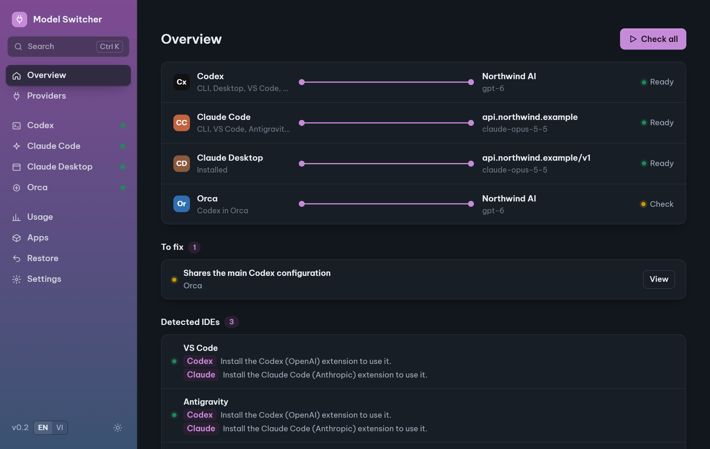
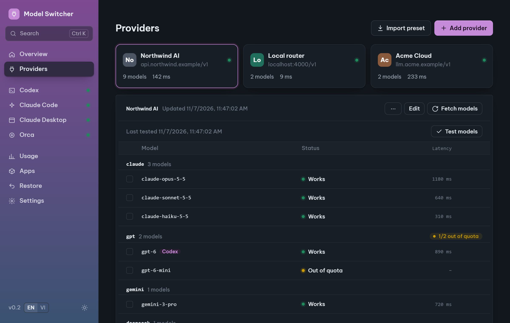
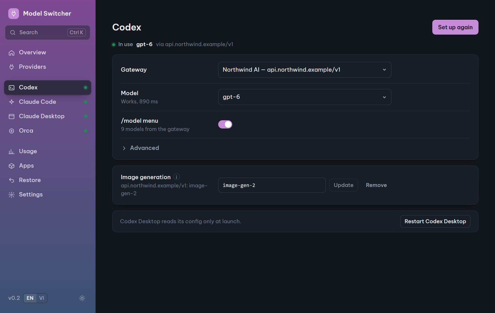
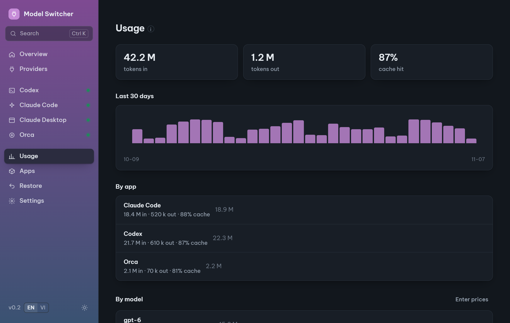

<div align="center">


# Model Switcher

### Use any AI gateway with Codex, Claude Code, Claude Desktop and Orca. One click to set up, one click to undo.

[](https://github.com/EK0720/model-switcher/releases)
[](https://github.com/EK0720/model-switcher/releases)
[](https://tauri.app/)
[](https://github.com/EK0720/model-switcher/actions/workflows/ci.yml)
[](LICENSE)

**English** · [Tiếng Việt](README.vi.md)



</div>

## Why Model Switcher?

You have an OpenAI- or Anthropic-compatible gateway: LiteLLM, OpenRouter, a company proxy, a local router. Pointing every coding tool at it means hand-editing `config.toml`, `settings.json`, Claude Desktop's third-party config and environment variables, then remembering how to put it all back when something breaks.

**Model Switcher** does it in one click, shows what each app is really using, and backs up every file it touches so any change can be undone.

- **See everything at once**: which gateway and model Codex, Claude Code, Claude Desktop and Orca use right now, and what is misconfigured.
- **Test before you switch**: check every model on a gateway (works, out of quota, key rejected, latency) and probe streaming, tools, prompt caching and images.
- **Undo anything**: every change is one undoable step. **Restore defaults** puts every app back the way it was before the tool.
- **Your keys stay yours**: stored in the OS keychain, masked in logs, errors, reports and presets. No telemetry, no account.
- **Fixes the classic errors**: Doctor finds stale variables behind HTTP 400 `reasoning_effort`, broken config files, proxies and managed policies, with one-click fixes.
- **Usage without uploads**: tokens, cache hit rate and cost estimates, read from logs already on your machine.
- **Codex image generation** through your gateway, transparent PNG by default.
- **Cross-platform**, English and Vietnamese, light and dark theme, Ctrl+K command palette.

## Screenshots

<table>
<tr>
<td align="center" width="50%"><br>Test every model on a gateway</td>
<td align="center" width="50%"><br>Set up Codex in one click</td>
</tr>
<tr>
<td align="center" colspan="2"><br>Usage from local logs, never uploaded</td>
</tr>
</table>

<sub>Screenshots use made-up gateways and numbers.</sub>

## Download

Get the latest build from [**Releases**](https://github.com/EK0720/model-switcher/releases).

| OS | File |
|---|---|
| Windows 10/11 | `Model.Switcher_x.y.z_x64-setup.exe` or `.msi` |
| macOS 11+ (Apple Silicon and Intel) | `Model.Switcher_x.y.z_universal.dmg` |
| Linux | `.AppImage` or `.deb` |

> [!IMPORTANT]
> Windows is tested on real machines. **macOS and Linux builds have not been tested on real machines yet** (they are built by CI). If you try one, a [test report](https://github.com/EK0720/model-switcher/issues/new?template=test_report.yml) (works or not) helps a lot.

> [!NOTE]
> Builds are **not code-signed** yet, so the first launch shows a warning:
> - **Windows** (SmartScreen "Windows protected your PC"): **More info → Run anyway**.
> - **macOS** ("cannot be opened because the developer cannot be verified"): right-click the app → **Open**, or run `xattr -dr com.apple.quarantine "/Applications/Model Switcher.app"`.
> - **Linux** (AppImage): `chmod +x model-switcher*.AppImage`, then run it.
>
> Compare the file's SHA-256 with the one on the release page: `Get-FileHash <file> -Algorithm SHA256` (Windows), `shasum -a 256 <file>` (macOS), `sha256sum <file>` (Linux).

## Quick start

1. **Providers → Add provider** (or **Import preset**): enter the base URL (usually ending in `/v1`) and the API key.
2. **Fetch models**, then **Test models** to see which ones work.
3. Open your app's page (Codex, Claude Code…), pick the provider and model, click **Set up**. Restart the app.

Changed your mind? **Restore → Undo** on that change, or **Restore defaults** for everything.

## What it changes

| App | File | Notes |
|---|---|---|
| Codex CLI / Desktop | `~/.codex/config.toml` | Provider and key variable default to `gateway` / `GATEWAY_API_KEY` so the gateway's name is not exposed (editable under Advanced). Adds the gateway's models to `/model` |
| Claude Code | `~/.claude/settings.json` | Adds a "From gateway" entry to `/model`. Your other settings, hooks and permissions are kept |
| Claude Desktop | Third-party inference `configLibrary` | Skipped if the machine has a managed policy. Can also remove old entries the tool did not create (undoable) |
| Orca | Nothing extra | Orca copies `~/.codex/config.toml` into its own Codex home; the tool shows whether it is in sync, with Sync now and daemon restart |

## FAQ

<details>
<summary><strong>Is my API key safe?</strong></summary>

Keys live in the OS keychain (Windows Credential Manager, macOS Keychain, Secret Service on Linux). They are written only where an app cannot read them any other way (Claude Code's `settings.json`, Claude Desktop's config). Keys never appear in logs, error messages, support reports or preset files. File backups are encrypted (DPAPI on Windows, AES-256-GCM with the key in the keychain elsewhere). The app talks only to the gateways you add; there is no telemetry.

</details>

<details>
<summary><strong>How do I go back to the official OpenAI / Anthropic login?</strong></summary>

**Restore → Restore defaults**. *Remove what the tool added* keeps your own edits; *Back to original* puts every file back exactly as it was before the tool first wrote it. Both can be undone too.

</details>

<details>
<summary><strong>Do I need to restart the apps after switching?</strong></summary>

Yes. Codex, Claude Code and Claude Desktop read their config at launch. Codex Desktop and Claude Desktop pages have a **Restart** button; start a new Claude Code or Codex CLI session in the terminal. For Orca, use **Restart daemon** on the Orca page.

</details>

<details>
<summary><strong>Claude Code says HTTP 400 <code>reasoning_effort</code></strong></summary>

Some gateways reject the effort parameter. Run **Doctor**: it removes a stale `CLAUDE_CODE_EFFORT_LEVEL` variable in one click. If the gateway detects Claude Code by its headers, the Claude Code page can add neutral compatibility headers.

</details>

<details>
<summary><strong>Which gateways work?</strong></summary>

Any gateway with an OpenAI-compatible `/v1/models` and `/v1/chat/completions` or `/v1/responses` (for Codex), and an Anthropic-compatible `/v1/messages` (for Claude Code and Claude Desktop). **Test models** tells you what a given gateway supports. To check by hand: `curl -s "$BASE_URL/models" -H "Authorization: Bearer $API_KEY"`.

</details>

<details>
<summary><strong>How is this different from CC Switch?</strong></summary>

[CC Switch](https://github.com/farion1231/cc-switch) is a great, broader tool: more CLIs, local routing, MCP and skills management. Model Switcher is narrower and focuses on changing configs safely: every write is undoable with encrypted backups, Restore defaults returns all apps to their original state, models are tested per gateway before you switch, Doctor fixes known gateway errors, and Orca is supported. Pick the one that fits.

</details>

<details>
<summary><strong>Something broke. How do I report it?</strong></summary>

Settings → **Support report** creates a report with keys and user folders masked. Review it, then open a [bug report](https://github.com/EK0720/model-switcher/issues/new?template=bug_report.yml). Security problems: please report privately, see [SECURITY.md](SECURITY.md).

</details>

## Build from source

Requires Node 20+, stable Rust and [Tauri's system dependencies](https://tauri.app/start/prerequisites/).

```sh
npm ci
npm run tauri dev      # run with hot reload
npm run tauri build    # package
cd src-tauri && cargo test
```

## Contributing

Issues and pull requests are welcome. Most wanted right now: **macOS and Linux test reports** and **translations**. See [CONTRIBUTING.md](CONTRIBUTING.md).

## Star history

[](https://www.star-history.com/#EK0720/model-switcher&Date)

## License

[MIT](LICENSE). Independent project, not affiliated with OpenAI or Anthropic.
